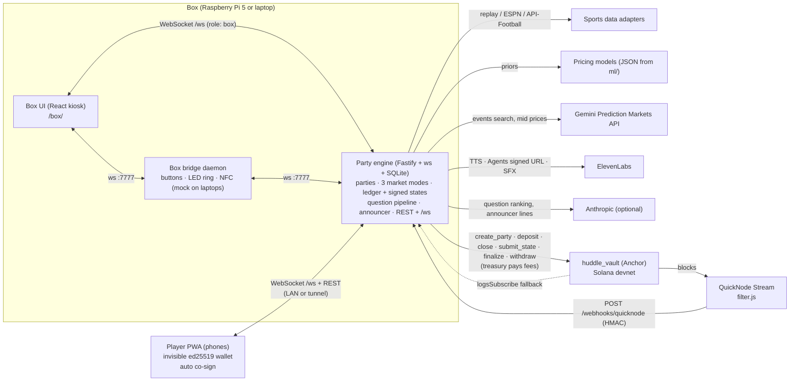

# Huddle

**A live prediction market for watch parties.** A box sits on the coffee table, friends join on their phones, and everyone bets on each moment of the game. Settlement runs through a vault on Solana.

Built for the UBC 2026 Hackathon. **Track:** Consumer Applications. **Chain award:** Best use of Solana. **Bounties:** Gemini Prediction Markets, ElevenLabs, QuickNode Streams.

**Try it live:**

| What | URL |
| --- | --- |
| Box screen (host a party) | https://huddle-nu-sooty.vercel.app/box/ |
| Phone app (join with the code or `/j/CODE`) | https://huddle-nu-sooty.vercel.app |
| Design tour, no game needed | https://huddle-nu-sooty.vercel.app/box/?fixture=kit and https://huddle-nu-sooty.vercel.app/?fixture=1 |
| Party engine (Render, also serves both apps) | https://huddle-engine-p1fc.onrender.com |

The engine runs on Render's free plan in points mode: after about 15 idle minutes it sleeps, and the first
visit then takes up to a minute to wake it. The web apps are static on Vercel (`vercel.json`); the engine
is the Render Blueprint in `render.yaml`.

> **Status, plainly:** the whole product runs end to end on one laptop in Replay mode with points. On-chain settlement (deposits, signed balances, finalize, payouts) works end to end on a **local** Solana validator. **The program is not deployed to devnet yet.** That is waiting on devnet SOL for the deploy (see [Solana](#how-we-use-solana)). ElevenLabs, Anthropic and QuickNode have only been exercised against mocks so far, because no API keys were available during the build. [What is mocked or unverified](#what-is-mocked-or-unverified) has the full list.

---

## The problem

Every watch party already has side bets: "$5 says he misses." Today they live in group chats and Venmo requests. Nobody tracks them, the odds are made up, losers forget to pay, and friends watching from another city can't join.

## What Huddle is

- **The box** is the party's host and bank, with a screen, a speaker, buttons and an LED ring. Friends scan or tap it to join. The box shows the live questions, the odds and the leaderboard. An AI announcer calls the action.
- **The phone app** (a PWA, no install and no wallet app) is each player's controller. Players join with a name, buy in with one tap, bet, cash out, and see their payout.
- **The AI** watches the game feed and opens a question at the right moment, such as "Will Ronaldo score this penalty?" It prices each question from models trained on real play-by-play data, and shows Gemini's regulated market price beside the room's price. **The LLM only writes words. It never sets a price or moves money.**
- **The money** sits in a Solana vault program. Bets are instant off-chain balance updates, signed by the box and countersigned by the player's phone. At the end, the vault pays everyone from the latest signed balances. The box can co-sign balances but **cannot move vault funds**.

### Three ways to play (per party, or per question)

| Mode | How it works | Code |
| --- | --- | --- |
| **Pool** | Everyone picks a side; winners split the pot pro rata. Rounding dust goes to the house. | `packages/shared/src/math/pool.ts` |
| **Market** | An LMSR market maker always quotes a price. Prices move as people trade, and you can cash out before the result. The house's worst-case loss is capped at its per-market budget. | `packages/shared/src/math/lmsr.ts` |
| **Bet** | Head-to-head between friends: one offers odds, another takes the other side. A one-tap bet first matches the best friend offer within 10% of fair odds, then posts the rest as an offer. | `packages/shared/src/math/bet.ts` |

### Design: game night with the lights on

The box and the phones share one design system, "Kickoff" (`DESIGN.md`; tokens in
`packages/shared/tailwind-preset.cjs`, shared components and motion in `packages/ui`). The idea:
playful where it is about people and moments, exact where it is about money.

- **Vibrant, light canvas:** a drifting colour field that takes on the two team colours while a moment
  market is open; solid game tiles for outcomes (YES blue, NO tangerine: colour-blind safe, never red
  vs green, always labelled).
- **Serious numbers:** tabular figures everywhere, exact "you pay / you get" before every bet, a live
  price-history line per market built from the trade feed, and Room vs Model vs Gemini side by side.
- **Motion with a job:** questions animate in word by word, every number rolls (odds, pot, balance,
  P&L, countdown), a broadcast-style takeover opens each moment market, the last five seconds
  escalate, the lock snaps shut, the winner's colour floods the stage, and coins fly into the pot and
  back out at payout. Every animation has a reduced-motion variant, and every entrance finishes even
  in a background tab, so content is never left invisible.
- **Every state is designed:** connecting, reconnecting, empty, error, voided, disputed, settling.
  Review them without an engine at `/box/?fixture=kit` (and 17 other `?fixture=` states) and
  `/?fixture=1|buyin|end|remote|offline|closing|points` on the phone.

## Quick start

Requirements: Node 20+ and pnpm 9. No `.env`, no API keys and no network are needed.

```sh
pnpm install
pnpm demo
```

`pnpm demo` (`scripts/demo.ts`) does the following:

- builds the box UI and the player app if their `dist/` is missing or stale;
- starts the mock box bridge and the party engine;
- creates a party on the soccer replay (Portugal vs Spain) and adds three bot players;
- opens two browser tabs: the box screen, already inside the party, and a player join link.

It prints a banner like this:

```text
  HUDDLE DEMO   Portugal vs Spain
  Party code   PNNP   ·   Pool mode   ·   settlement: points
  Box screen   http://localhost:8080/box/  (opened already inside the party)
  Join link    http://localhost:8080/j/PNNP
  Phones       http://192.168.1.20:8080/j/PNNP  (same Wi-Fi; the QR on the box)
```

Then:

1. In the player tab, type a name and tap **Buy in**.
2. On the box, tap **Tap to enable sound**, then **Start game**.
3. Bet as questions appear. Box keys: **L** locks, hold **T** to talk, **N** shows the next screen.
4. Ctrl-C stops everything.

Options:

| Flag | Values |
| --- | --- |
| `--game` | `replay-por-esp` or `replay-ten-dal` |
| `--mode` | `pool`, `market` or `bet` |
| `--players N` | number of bots |
| `--speed X` | 0.25 to 20; the engine's timers scale with it |
| `--settlement` | `points`, `trusted` or `vault` |
| `--autostart` | start the replay without waiting for the host |
| `--no-open` | do not open browser tabs |
| `--no-bridge` | do not start the mock bridge |
| `--keep-data` | keep the party data after exit |

Ports come from `PORT` (default 8080) and `BRIDGE_PORT` (default 7777).

**Real on-chain settlement without devnet SOL:** `sh scripts/solana-localnet.sh` builds the program if needed, starts `solana-test-validator` with huddle_vault loaded at its real program ID, creates a test USDC mint, and starts the engine with `SETTLEMENT=vault`. Then open `http://localhost:8080/box/` and choose **Vault** when you create the party. It needs the Solana CLI and Anchor (`scripts/solana-env.sh`).

### The manual path

```sh
pnpm --filter @huddle/box --filter @huddle/player build   # UIs, served by the engine
pnpm --filter @huddle/engine start                        # engine on :8080: box at /box/, player app at /, joins at /j/CODE
pnpm bridge:mock                                          # optional: mock bridge on :7777 (keys L / T / N, LED preview)
pnpm bots -- --party CODE --n 5                           # optional: bot players
```

Dev servers with hot reload: `pnpm --filter @huddle/box dev` (port 5174) and `pnpm --filter @huddle/player dev` (port 5173). Both proxy to the engine on 8080.

## Architecture



How a moment works:

1. The sports adapter emits a normalized event, such as `penalty_awarded`.
2. The question engine proposes a market with a model prior and a lock rule.
3. The optional LLM ranker only picks and phrases the question.
4. The engine opens the market.
5. Phones bet, and every balance change produces a new signed state.
6. The market locks on its countdown or when the event happens.
7. A resolver decides the result from the feed.
8. A 20 s dispute window follows, then the result is final.

At the final whistle the engine voids anything unresolved, collects the last countersignatures, and closes the vault.

## How we use Solana

| | |
| --- | --- |
| Program | `huddle_vault`, Anchor 1.2.2, `programs/huddle_vault/src` |
| **Program ID** | **`GRpABdrQhDya9n2zuf19w2idbL3CRSqmWYTJs52taRHu`** (from `declare_id!` and `Anchor.toml`; derived from the program keypair) |
| **Devnet deploy transaction** | **None yet.** The deploy is blocked on devnet SOL: the public RPC faucet answers `410 Gone`. The steps are below. |
| Verified | 21 on-chain tests on a local validator (`pnpm solana:test`). The engine, in vault mode on a local validator (`scripts/solana-localnet.sh`), ran a full party: create_party, phone-signed deposits, close, submit_state, finalize and withdraw. Wallet balances on chain matched the engine's payouts exactly (80 USDC in, 80 out, vault empty). |
| TS client | `packages/solana-client`. `VaultSettlementClient` implements the same `SettlementClient` interface as the in-memory mock. Its integration test checks the two against each other field by field. |

**Why Solana:**

- Sub-second confirmation, so a buy-in shows on the box while the player is still holding the phone.
- Fees low enough that the treasury can pay every fee and rent as fee payer, so players and the host never need SOL.
- SPL USDC as the unit of account.
- The Ed25519 signature-verify program lets the vault check off-chain signed balances on-chain, so betting can stay instant and free.

### Instructions

| Instruction | What it does |
| --- | --- |
| `create_party(party_id, box_signer, challenge_secs, bond, require_member_sig)` | The host creates the party and deposits the bond into the vault. |
| `deposit(amount)` | Creates the Member account if needed and moves USDC from the player to the vault. The treasury pays the fee. |
| `request_close()` | Callable by the host or the box signer at any time, or by any member 6 h after creation. Starts the challenge window (60 s by default, capped at 7 days). |
| `submit_state(member, nonce, balance, state_hash)` | Anyone can submit a member's signed balance during the window. A higher nonce replaces a lower one. |
| `finalize()` | Anyone, after the window. A member with no submitted state is paid back their deposit. |
| `withdraw()` / `withdraw_host()` | Cranks anyone can call. Pay a member (or the host refund) to their own associated token account. |

### Account layout

- **`Party`**: PDA seeds `["party", host, party_id]`, 294 bytes. Fields:
  - `host`, `party_id [u8;32]`, `box_signer`, `mint`;
  - `vault`: an SPL token account, PDA `["vault", party]`, owned by the Party PDA;
  - `status` (Open / Closing / Finalized), `require_member_sig`;
  - `member_count`, `claims_count`, `withdrawn_count`, `challenge_secs`;
  - `created_at`, `close_requested_at`, `finalized_at`;
  - `total_deposits`, `bond`, `claimed_deposits`;
  - `sum_claims u128`, `finalized_sum u128`, `available`;
  - `cut`, `host_refund`, `host_refund_paid`, `total_paid`.
- **`Member`**: PDA seeds `["member", party, wallet]`, 139 bytes. Fields: `party`, `wallet`, `deposited`, `claim_balance`, `claim_nonce`, `claim_state_hash`, `has_claim`, `withdrawn`, `paid_out`.

### Signed balance message

```text
"HUDDLE_STATE_V1" (15 bytes) || party_pubkey (32) || member_pubkey (32)
|| nonce (u64 LE) || balance (u64 LE, USDC base units) || state_hash (32)          = 127 bytes
```

The box signer signs every state, and so does the member's in-browser wallet when `require_member_sig = true`.

`state_hash = sha256(prev_hash || canonical JSON of the ledger entries since the last state)`. The phone countersigns only after it checks four things: the box signature, nonce + 1, the hash chain, and that the entries add up.

On-chain, the transaction carries Ed25519 program instruction(s) before `submit_state`. The program rebuilds the message from its own arguments, reads the instructions sysvar, and counts only signature entries that point at the Ed25519 instruction itself.

### Settlement design and risks

There are three settlement modes, chosen per party:

- **Vault + signed balances** (default for real money): as described above.
- **Trusted host:** box-only signatures, using the same program.
- **Points:** no chain at all. The same engine runs the same vault rules through an in-memory mock.

**The demo and the e2e tests ran in points mode.** The vault path was verified on a local validator, not on devnet.

Economic design:

- **House budget.** The host's engine-held "house" key deposits a market-maker budget: 50 USDC per party, at most 6 per Market-mode market. The house can lose at most that per-market budget. LMSR liquidity is `b = L / max(ln n, ln(1/minPrior))`, so the bound holds for any opening prior. When the house budget runs low, new Market-mode questions fall back to Pool.
- **Rounding** always favours the house: buys round up, sells and payouts round down, and dust goes to the house. Money is conserved exactly. The ledger total equals deposits at every step, which is checked after every action in tests and in a 1,000-action fuzz.
- **Stake limits.** A player's total in one market can be at most 50% of their balance plus what they already have in it. The host sets the buy-in, and the maximum buy-in is 5x.
- **Bond and shortfall** (finalize, verified against the reference `settleClaims` in Rust tests, a 500-round fuzz, and on-chain):
  - The finalized sum is the sum of claims plus the deposits of members who submitted no state.
  - The money available is total deposits plus the bond.
  - If the finalized sum is within what is available, everyone is paid in full and the host gets back the bond plus any surplus.
  - Otherwise the bond covers the shortfall first, then every claim is **cut pro rata**: `payout_i = floor(claim_i * available / finalized_sum)`. The dust goes to the host.
- **Why the box can't run off with the pot.** The box can only co-sign balances. Each player holds their own latest co-signed state and can submit it. Unsubmitted losers default to their full deposit, and any shortfall comes from the host's own bond first.
- **Known limit.** A box signer that colludes with one member can sign that member an inflated balance. Once the bond is used up, everyone else is cut pro rata. The bond is the deterrent. This is not a full state channel.
- **Other risks:**
  - Party, Member and vault accounts are never closed, so their rent stays locked (about 0.007 SOL per party plus 0.002 per member).
  - A deposit reported by the QuickNode webhook is credited on the strength of the stream's signature alone. The engine does not re-read the transaction from RPC.
  - In vault mode the phone signs deposit transaction bytes it does not decode. This is a devnet-only trade-off that keeps `@solana/web3.js` out of the PWA.

### Deploying to devnet (needs a human)

```sh
# 1. Send 3+ devnet SOL to the treasury 91mP4ejdaRN6kFL8rmG5QmsjE4hJk7uFUrhoeSTC2BDi (https://faucet.solana.com)
export HUDDLE_KEYS_DIR="$HOME/.config/huddle/devnet"
pnpm solana:setup     # test USDC mint, env file
pnpm solana:deploy    # prints "Program Id" and "Signature" (the deploy transaction)
pnpm solana:setup     # writes HUDDLE_PROGRAM_ID
# 2. Copy ~/.config/huddle/devnet/.env.solana into .env, set SETTLEMENT=vault, and record the signature here.
```

## QuickNode Streams

| | |
| --- | --- |
| Network | Solana devnet |
| Dataset | Block (`getBlock` shape). The filter also accepts the "Programs + Logs" shape. |
| Filter | [`scripts/quicknode/filter.js`](scripts/quicknode/filter.js) |
| Destination | Webhook `POST {PUBLIC_ENGINE_URL}/webhooks/quicknode`, verified with the Stream's security token |
| Setup | `pnpm quicknode:stream` (QuickNode REST API when `QUICKNODE_API_KEY` is set) or the dashboard steps in [`docs/quicknode-stream.md`](docs/quicknode-stream.md) |

**Filter logic.** The filter keeps only successful transactions (`meta.err` null) that invoke `HUDDLE_PROGRAM_ID`. It resolves lookup-table accounts and decodes the Anchor instruction discriminator. It then emits one record per Huddle instruction: `{ signature, slot, blockTime, instruction, accounts, partyPda, member, amount? }`. For `withdraw`, the amount is the on-chain payout, read from the program's own `Withdrawn` event log. The decoder is an inlined copy of `packages/solana-client/src/decode.ts`, and a unit test fails if the two drift.

**What the engine does with it.**

- It verifies `X-QN-Signature` = HMAC-SHA256(token, nonce + timestamp + body).
- It credits deposits exactly once per signature.
- It broadcasts close, submit_state, finalize and payout events to the box and phones as `chain_event` messages with `via: "quicknode"`.

**Why Streams.**

- Ordered, pushed delivery lets the box react the moment money moves, with no polling.
- The filter runs on QuickNode's side, so a Pi on venue Wi-Fi receives only our transactions, not every devnet block.
- Deposits made outside the app are still credited.

**Fallback.** Without a Stream, `VaultSettlementClient.subscribe()` subscribes to program logs over the RPC WebSocket and decodes the same events (`via: "rpc"`). Streams is the primary path.

**Verified:** `scripts/quicknode/filter.test.ts` runs the filter in a bare sandbox against synthetic blocks built with the real instruction builders. `webhook.test.ts` posts the filter output with QuickNode-style HMAC headers to a running engine and sees the deposit credited once.

**Not done:** creating a real Stream. That needs an account, a public engine URL and the devnet deploy.

## ElevenLabs

The announcer is the room's voice: it calls every key event (`packages/announcer`, see [A6](docs/workstreams/A6.md)).

| Product | How Huddle uses it |
| --- | --- |
| **Text to Speech** | Every callout uses the streaming endpoint `POST /v1/text-to-speech/{voice_id}/stream` with the low-latency `eleven_flash_v2_5` model. There is one stock voice and one set of voice settings per persona (Soccer, NFL, Calm). Clips are cached by hash(voice + model + settings + text) in memory and on disk. Common countdown lines are pre-generated at party start. Any line that can't be voiced within 2.2 s of the event is spoken by the browser (Web Speech) instead. Captions always show. |
| **ElevenLabs Agents** | Powers the box's TALK button and the app's mic. It is a private agent: the engine issues a signed conversation URL with `party_code`, `player_name` and `session_token` as dynamic variables. It has four server tools, all webhooks to the engine authenticated with a shared secret: `get_party_state`, `get_market`, `explain_odds` and `draft_bet`. Only `draft_bet` writes anything, and it only creates a draft the player must confirm in the app. The agent can never move money. |
| **Sound Effects** | Five stingers (goal horn, crowd roar, lock buzzer, cash register, sad trombone) are generated once with `POST /v1/sound-generation` (`pnpm --filter @huddle/announcer sfx`). |

**Verified vs awaiting keys.**

- **Verified without keys** (104 unit and local-HTTP tests): request shapes, caching, latency budgets, fallbacks, every line template, and the rule-based TALK answers.
- **Not yet run against the real ElevenLabs API:** no key was available. The sound-effect files have not been generated yet, so the box synthesizes the five stingers with Web Audio. Two of the three default voice IDs were not confirmed in the docs; a rejected voice falls back to George. Setup steps are in `packages/announcer/agent/AGENT_SETUP.md`.

No voice is cloned, and no real commentator is imitated.

## Gemini Prediction Markets

The feature is **"Friends vs. the Pros"**. On every comparable market, the phones and the box show three prices side by side: the room's price, our model's price, and Gemini's live mid price, with an "as of" time. At full time, a scorecard ranks Friends vs. Model vs. Gemini by Brier score. Gemini's prices also **calibrate our NFL model**: the moneyline and total line feed the priors before kickoff (`packages/gemini`, `packages/models`).

Endpoints used (public, no key):

- `GET https://api.gemini.com/v1/prediction-markets/events?status=active&category=sports&search=<text>&limit=50`
- `GET https://api.gemini.com/v1/prediction-markets/events/{eventTicker}`

Matching needs the league and **both** teams; one team is never enough. The price shown is the mid price, or "unavailable" when the book is too thin.

Real output on Nov 16 2026 (`pnpm --filter @huddle/gemini demo -- "Cowboys"`, trimmed):

```text
Tennessee vs Dallas  (TEN at DAL, starts 2026-11-22T18:00:00.000Z)
  NFL-2611221800-TEN-DAL-M  [moneyline]  Tennessee vs Dallas
      Dallas                                       bid 0.79  ask 0.80  last 0.80  ->       79.5% (mid)
      Tennessee                                    bid 0.20  ask 0.21  last   -   ->       20.5% (mid)
  NFL-2611221800-TEN-DAL-T  [total]  Tennessee vs Dallas: Total Points
      More than 53.5 points scored                 bid 0.46  ask 0.54  last   -   ->       50.0% (mid)
  link: https://www.gemini.com/predictions/NFL-2611221800-TEN-DAL-M/tennessee-vs-dallas
```

Wired through the engine factories, against the live API:

```text
Tennessee Titans at Dallas Cowboys: available=true source=live events=9 (433 ms)
  calibrated model: {"pHome":0.795,"totalMean":55.19,"totalLine":53.5,"source":"gemini"}
  Who wins: Titans or Cowboys? prior={"home":0.795,"away":0.205} -> gemini Dallas 0.795 for outcome home
Portugal vs Spain: available=false ... Gemini column hidden for this game.
```

Differences from the API description in our PRD, all found with curl before coding:

- Lists are wrapped in `{ data, pagination }`.
- `search` matches titles and tickers (which use city names), not team nicknames.
- Contract tickers are short (`DAL`, `O53`); the long symbol is `instrumentSymbol`.
- Events carry `participants[]` and `sportsMarket.type`.
- Quarter and half markets had no book days before the game.
- The PRD's example market (SF at DAL) had already settled. That is why the NFL replay is TEN at DAL, which is listed for the hackathon week.

**Limits:**

- Offline, the client shows clearly flagged sample odds (`GEMINI_MOCK=1` forces this). The e2e tests use the mock.
- After Nov 22 the TEN at DAL market settles. Set `GEMINI_EVENT_TICKERS` to pin a current game.
- The P1 WebSocket quotes are not built.

## AI question generator and pricing models

- **Pipeline** (`packages/models/src/engine.ts`):
  1. A normalized game event comes in.
  2. Template trigger rules propose candidate markets, each with a model prior, a lock rule and a resolver.
  3. An optional LLM ranker (Anthropic, 1.5 s budget, schema-validated) picks and phrases one. Code rejects any number not in the candidate, over-long text, and loss-chasing phrases. Any failure falls back to the template text.
  4. Resolvers decide outcomes from the feed.
- **Templates:**
  - Soccer: match winner, team goals, total goals, penalty, corner shot on target, card before halftime, half winner, next goal.
  - NFL: winner, total, quarter and half winners, drive result, 3rd and 4th-down conversion, red-zone touchdown.
- **Models and data sources.** All models are JSON evaluated in TypeScript; no Python runs live.
  - **NFL** (`nfl.json`): nflverse play-by-play, 2021 to 2025 regular seasons, 235,933 plays and 1,359 games, trained with `ml/train_nfl.py`. It covers conversion tables (3rd and 1: 69%, 3rd and 7 to 10: 32%), 4th-down go rates, drive and red-zone outcomes, period winners and score distributions, plus scikit-learn logistic regressions exported as coefficients.
  - **Soccer** (`soccer.json`): StatsBomb open data, 1,813 matches (World Cups 2018 and 2022, Euros 2020 and 2024, Copa América 2024, and the 2015/16 seasons of the top five leagues), trained with `ml/train_soccer.py`. Penalty base rate 74.05% (371 of 501), corner shot on target 8.9%, cards per half. Poisson goal rates use the PRD defaults (1.35 / 1.10). Data: [StatsBomb Open Data](https://github.com/statsbomb/open-data); thanks to StatsBomb.
  - **Hand-entered:** the penalty taker career tallies (Ronaldo 172 of 205 and four others) are approximate, flagged in the JSON, and used only through shrinkage (k = 20). They move the hero market from 74% to 83%.
- **Replays** (`replays/`): two hand-authored demo timelines, Portugal vs Spain (6 min 50 s, with the Ronaldo penalty at 0:32) and Titans at Cowboys (4 min 56 s). Live ESPN and API-Football adapters exist but have not been watched through a real live game.

## Repo layout

```text
apps/engine        party engine: Fastify + ws + SQLite; REST, /ws, webhooks, static hosting of both UIs
apps/box           box kiosk UI (React + Vite + Tailwind), served at /box/
apps/player        player PWA (React + Vite + Tailwind), served at /, joins at /j/CODE
apps/box-bridge    hardware daemon: buttons, LED ring, NFC; --mock for laptops
packages/shared    types, zod protocol, HuddleClient, signed-state encoding, LMSR / pool / bet / settle math
packages/sports    replay, ESPN, API-Football adapters -> one normalized event stream
packages/models    question engine, templates, resolvers, pricing tables (JSON)
packages/gemini    Gemini Prediction Markets client
packages/announcer LLM lines, ElevenLabs TTS / Agents / SFX, Web Speech fallback
packages/solana-client  huddle_vault TS client, decoders (used by the Streams filter)
programs/huddle_vault   Anchor program
ml/                training scripts (nflverse, StatsBomb) -> packages/models/models/*.json
replays/           recorded game timelines
scripts/           demo runner, QuickNode filter + stream setup, Solana scripts, Pi installer + systemd units
e2e/               Playwright end-to-end tests
docs/              QuickNode setup, per-workstream notes (docs/workstreams/A1..A6.md)
```

## Environment variables

Everything is optional. With nothing set, Huddle runs in Replay mode with mocks and points. The full list with comments is in [`.env.example`](.env.example). The main ones:

| Variable | Purpose |
| --- | --- |
| `PORT`, `DATA_DIR`, `SETTLEMENT` | Engine port, SQLite and key folder, and default settlement (`points`, `trusted` or `vault`) |
| `PUBLIC_ENGINE_URL` | Public tunnel URL for remote players and the Streams webhook. Without it, join links use the LAN IP. |
| `SOLANA_RPC_URL`, `SOLANA_CLUSTER`, `HUDDLE_PROGRAM_ID`, `USDC_MINT`, `TREASURY_SECRET_KEY`, `BOX_SIGNER_SECRET_KEY` | Vault mode (devnet or localnet). Mainnet endpoints are refused. |
| `QUICKNODE_STREAM_SECRET`, `QUICKNODE_API_KEY` | Webhook verification; Stream creation |
| `ANTHROPIC_API_KEY`, `LLM_MODEL` | Question ranker and announcer lines (templates without a key) |
| `ELEVENLABS_API_KEY`, `ELEVENLABS_AGENT_ID`, `ELEVENLABS_VOICE_*`, `AGENT_TOOLS_SECRET` | Voice, agent and agent tools (Web Speech without a key) |
| `SPORTS_PROVIDER`, `API_FOOTBALL_KEY` | `replay` (default), `espn` or `apifootball` |
| `GEMINI_MOCK`, `GEMINI_FALLBACK`, `GEMINI_EVENT_TICKERS` | Gemini offline sample, hiding the column, pinning events |

## Testing

| Command | What it runs |
| --- | --- |
| `pnpm test` | All package unit and integration tests (Vitest), then `scripts/` tests (QuickNode filter + webhook) |
| `pnpm e2e` | Playwright, Chromium only. Real box and player pages against an engine with the real replay and question engine at 10x. Pool and Market mode in the browser; all three modes with bot players. Run `pnpm e2e:install` once first. Test hooks are listed in [`e2e/README.md`](e2e/README.md). |
| `pnpm solana:test` | `anchor test` on a local validator: 21 on-chain tests (needs Solana CLI + Anchor) |
| `pnpm typecheck`, `pnpm lint` | TypeScript strict across the monorepo; ESLint |

CI (`.github/workflows/ci.yml`) runs install, typecheck, lint, unit tests and e2e. The Anchor tests need the Solana toolchain and run locally.

## Raspberry Pi install

`sudo ./scripts/pi-setup.sh`, run on Raspberry Pi OS Bookworm 64-bit from the repo root:

- installs Node 22 and pnpm;
- builds the UIs;
- creates `/etc/huddle/huddle.env` (mode 600) and the box signer key;
- installs systemd units from `scripts/systemd/`: `huddle-engine`, `huddle-bridge`, `huddle-kiosk` (Chromium kiosk at `http://localhost:8080/box/`), and, when `CLOUDFLARE_TUNNEL_TOKEN` is set, `huddle-tunnel` (Cloudflare Tunnel for `PUBLIC_ENGINE_URL`).

The real hardware adapter (`apps/box-bridge/src/hardware.ts`, `PiHardware`) is a skeleton for our hardware engineer. The bridge contract is PRD section 10.

## Safety and legal

- **Devnet only.** All money in this project is Solana devnet test USDC, and mainnet RPC endpoints are refused. No real-money wagering is offered.
- **Points mode** is built in for zero-money play, and it is what the demo runs by default.
- Real-money social betting is regulated differently in every jurisdiction. A real launch would need legal review, licensing, age verification (21+ in many US states), geofencing and responsible-gaming controls.
- Guardrails already built: per-market stake limits, a host-set maximum buy-in, no house rake in friends mode, announcer lines that never encourage chasing losses (checked in code), and voice bets that are only drafts the player must confirm.
- Not affiliated with any league, team, federation or betting operator. Replay timelines are hand-authored. No voice cloning, and no imitation of real commentators.

## What is mocked or unverified

- **Solana:** nothing has run on devnet. There is no deploy and no deploy transaction. Verified on a local validator only.
- **QuickNode:** no real Stream exists yet. The filter and webhook are verified with synthetic blocks. The exact devnet network string (`solana-devnet`) and the payload's `slot` field could not be confirmed in the docs; the filter handles both shapes.
- **ElevenLabs and Anthropic:** never called with real keys. The sound-effect files are not generated. Voice IDs need confirmation by ear.
- **Live sports** (ESPN, API-Football) are tested on recorded and synthetic payloads only. The penalty career tallies are hand-entered.
- **Hardware:** the bridge runs in mock mode. GPIO, LEDs and NFC on the Pi are not implemented yet.
- **Not built:** Gemini WebSocket quotes, Solana Pay deposits from external wallets, withdraw to an external wallet, and the cross-party "Huddle network" leaderboard.

## What we would build next

1. Deploy to devnet, turn on the QuickNode Stream, and run a vault party through to payouts on the explorer.
2. Real box hardware: NFC tap-to-join, button and LED wiring, and the kiosk on the Pi.
3. Solana Pay deposits from Phantom or Solflare, and withdrawals to any wallet.
4. Gemini real-time quotes over WebSocket, and Gemini-calibrated soccer models.
5. A network of boxes: shared leaderboards across bars and campuses, and the same box running other social games.
